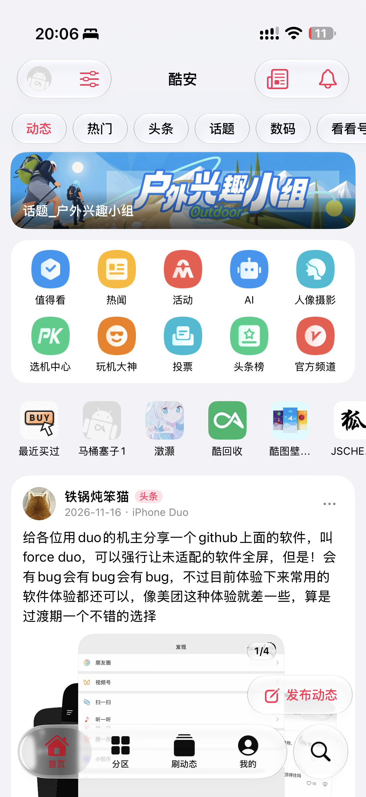
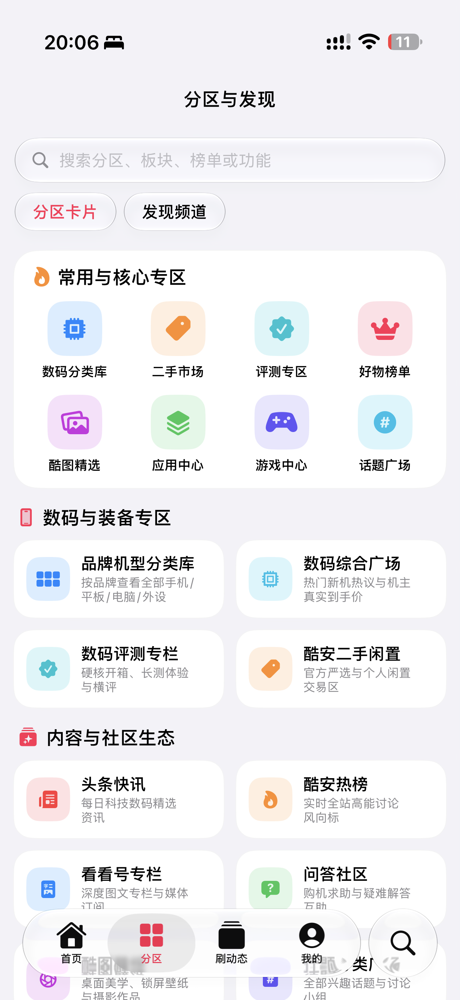
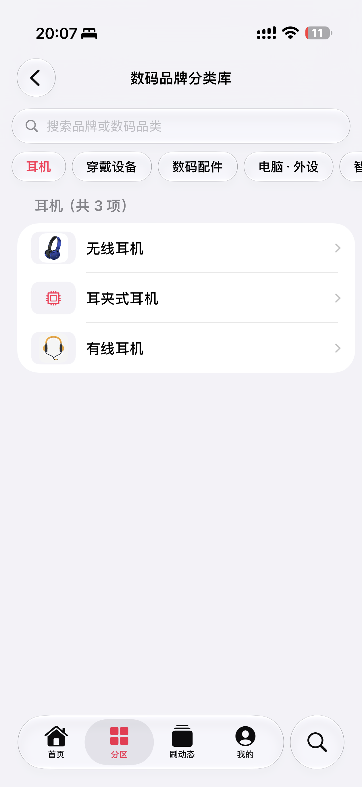
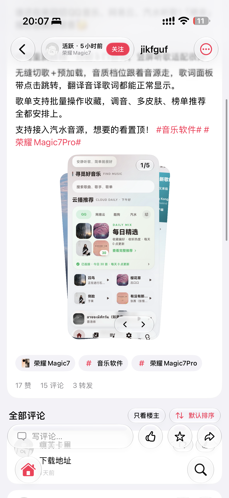
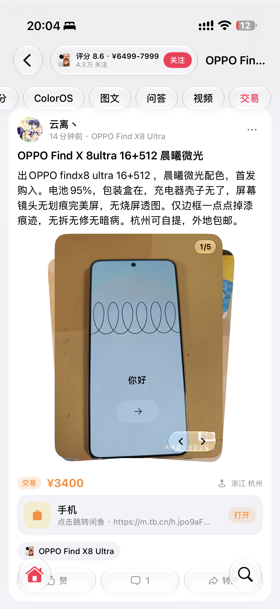
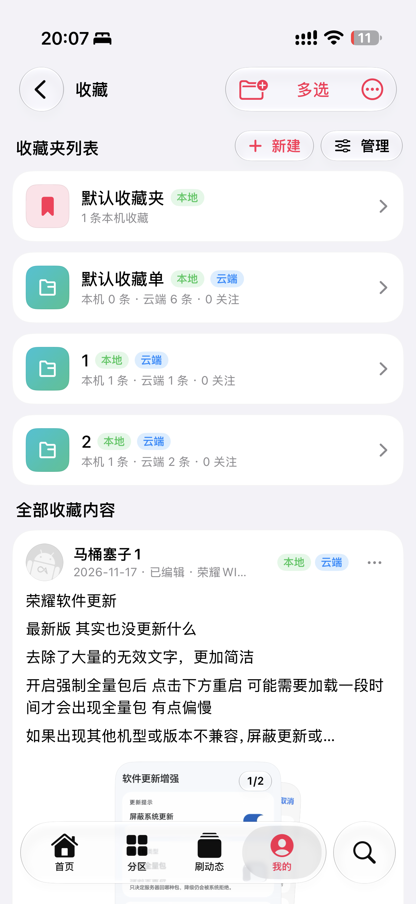
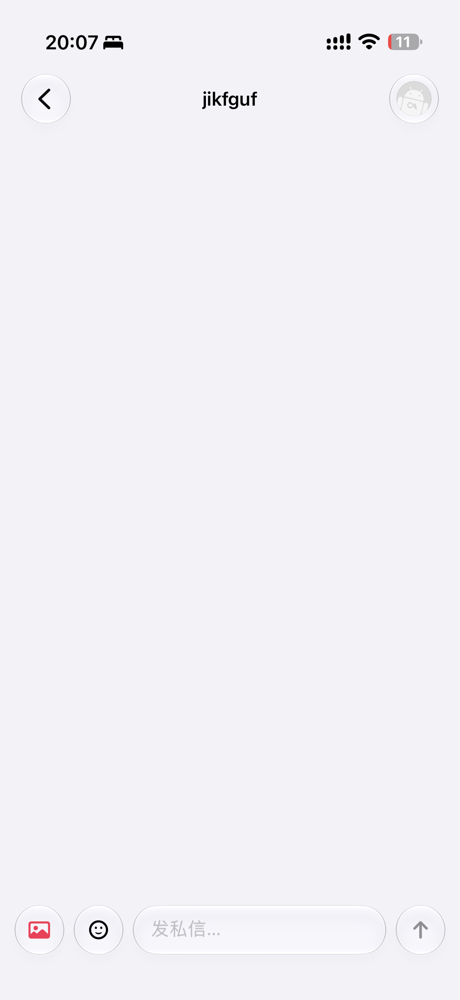
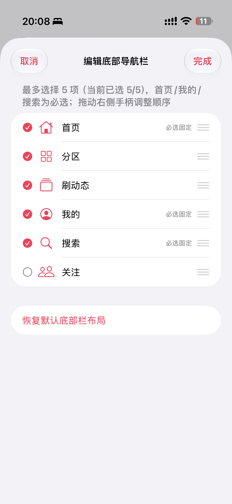

<div align="center">

<!-- ===================================================================== -->
<!-- 预留 App 图标位置：将下方 src 替换为你的 App 图标路径，例如 docs/assets/logo.png -->
<!-- ===================================================================== -->
<p align="center">
  <a href="https://github.com/AsrielXuwu/swift-c001apk">
    
  </a>
</p>

# Swift C001APK（S001）

### ✨ 「 iOS 端最好的酷安第三方客户端，没有之一 」 ✨

<p align="center">
  <b>100% 纯正原生 Swift 6 + SwiftUI 打造 · 遵循 Apple iOS 27 Liquid Glass（液态玻璃）设计规范</b><br/>
  无广告 · 零追踪 · 全功能覆盖 · 丝滑无缝缩放过渡动画 · 本机与云端双轨同步
</p>

<p align="center">
  <a href="https://github.com/AsrielXuwu/swift-c001apk/releases/latest">
    
  </a>
  <a href="https://github.com/AsrielXuwu/swift-c001apk/actions/workflows/build.yml">
    
  </a>
  
  
  <a href="https://github.com/AsrielXuwu/swift-c001apk/blob/main/LICENSE">
    
  </a>
  <a href="https://t.me/swift_c001apk">
    
  </a>
</p>

<p align="center">
  <a href="#-项目简介">项目简介</a> •
  <a href="#-核心特色与优势">核心特色</a> •
  <a href="#-应用截图预览">应用截图</a> •
  <a href="#-快速下载与安装含国内加速">快速下载</a> •
  <a href="#️-自定义编译与改名--改包名--换图标指南">自定义修改指南</a> •
  <a href="#-bug-反馈与交流社区">反馈与交流</a> •
  <a href="#-开源协议与免责声明">协议与免责声明</a>
</p>

</div>

---

## 📖 项目简介

**Swift C001APK（简称 S001）** 是一款专为 iOS / iPadOS 平台深度定制的开源第三方酷安（Coolapk）客户端。

本项目参考并融合了 [TG-Twilight/c001apk](https://github.com/TG-Twilight/c001apk)、[frisk1127/c001apk-Revived](https://github.com/frisk1127/c001apk-Revived)、[daimiaopeng/coolapk-desktop](https://github.com/daimiaopeng/coolapk-desktop) 以及 [Mora-han/coolapk-for-mac](https://github.com/Mora-han/coolapk-for-mac) 等优秀开源项目的协议与功能设计，使用 **100% 原生 Swift 6 + SwiftUI** 重新构建。在彻底剔除官方客户端臃肿广告、开屏推广与后台追踪的同时，提供符合 **Apple 官方最新 iOS 27 Liquid Glass（液态玻璃）** 规范的交互体验与完整的酷安社区生态功能。

---

## 🌟 核心特色与优势

### 1. 💎 纯正 Apple 原生 SwiftUI 与 iOS 27 液态玻璃（Liquid Glass）美学
- **零 WebView 套壳**：全界面采用原生 SwiftUI 组件构建，支持 120Hz ProMotion 高刷滚动、异步并发图片管线与物理弹簧手势。
- **全场景无缝缩放过渡（Matched Zoom Transition）**：从首页卡片、分区与发现卡片、个人中心功能项、收藏夹卡片到用户头像，点击即从源位置丝滑无缝展开详情页，右滑返回原位闭合。
- **悬浮液态玻璃胶囊（FloatingTabStrip）**：顶部分类栏、分区切换栏与详情页收起式迷你信息顶栏均采用原生 `.glassEffect` / `.ultraThinMaterial` 悬浮毛玻璃胶囊，通透纯粹。
- **底部 Tab 栏自由定制**：支持在「设置 → 界面与底部栏定制」中自由调整底部 Tab 栏（首页 / 分区 / 关注 / 消息 / 我的）的**显示顺序**与**显隐开关**。

### 2. 🧭 完整的「分区与发现」及数码生态全覆盖
- **首页全频道覆盖**：支持热榜、动态（含 3D 堆叠卡片轮播图）、热议话题、问答列表、二手交易、好物榜、酷图、数码产品（含结构化**到手价**智能提取）、数码评测专栏及 10+ 兴趣垂直频道。
- **独立「分区与发现」中心**：
  - **导航分区**：快捷直达酷安热榜、话题广场、二手专区、看看号广场、数码评测专栏、问答专区與新机列表。
  - **发现聚合**：完整呈现精选与必看话题、大家都在聊、酷品好物推荐与榜单、精选看看号与近期热议排行榜。
- **原生 SwiftUI 数码品牌分类库**：采用顶部悬浮品牌类型胶囊 + 原生 `.insetGrouped` 列表设计，支持平板与大屏多列自适应、机型/产品参数配置表查阅，以及**多版本（如不同内存/存储配置）同屏高亮差异对比**。
- **应用商城详情页**：完整展示 App 图标、版本号、包体积、下载量、开发者信息、10 分制星级分布图、更新日志、横向截图画廊与按热度/时间排序的用户评论。

### 3. 🔄 本机 + 云端「双轨同步」收藏、关注与悄悄关注
- **双轨收藏夹系统**：支持将帖子同时或分别收藏至**本机收藏夹**与**云端收藏夹**，列表内实时渲染「本地 / 云端」双徽章，点击统计卡片即可按全部、仅本地、仅云端快速过滤。
- **双轨关注与悄悄关注（Local Follow）**：除了账号云端关注外，支持**无需登录、对方无感知的本机悄悄关注**，并在关注列表中通过双角标清晰区分。
- **可折叠浏览历史**：按今日、昨日与更早日期自动分组且支持一键折叠/展开、关键词搜索及 JSON 备份导入导出。

### 4. 💬 原生级私信聊天、智能剪贴板与 URL Scheme 深度跳转
- **原生私信体验**：顶部展示对方昵称与右侧头像（支持无缝缩放进出用户空间），底部输入栏与大圆角表情筛选面板精准跟随系统键盘丝滑抬升，支持发送多图与酷安原生表情。
- **剪贴板链接智能识别**：从后台切回 App 时自动检测剪贴板中的 `coolapk.com` 帖子、用户、话题或数码产品链接，弹出轻量提示一键直达对应页面。
- **完整 URL Scheme 支持**：支持 `coolapk://`、`c001apk://` 与通用链接跳转，方便从 Safari、快捷指令或其他第三方 App 无缝唤起本客户端。

### 5. 🛡️ 极致纯净的阅读、创作与防刷屏过滤引擎
- **全格式内容渲染**：原生支持图文混排、长文 Article、酷图多图网格、**实况照片（Live Photo）**、视频播放、投票帖、问答帖、转发嵌套卡片、评分卡与二手机型价格标签。
- **多维内容静音与黑名单**：支持按关键词、正则表达式、指定用户 UID 或话题 Tag 精准屏蔽，支持折叠或直接隐藏。
- **双模式登录与设备伪装**：支持 WebView 扫码/账号安全登录与手动 Token 导入，内置 `X-App-Token v2` 与自定义 `DeviceIdentity` 签名算法。

---

## 📸 应用截图预览

> 📌 *以下为应用截图展示位（你可以将实机截图放入仓库 `docs/screenshots/` 目录并替换下方图片路径）：*

<div align="center">

| 首页 · 动态与堆叠轮播 | 分区与发现中心 | 数码品牌分类库与参数对比 | 帖子详情与到手价识别 |
| :---: | :---: | :---: | :---: |
|  |  |  |  |

| 个人中心（原生 SwiftUI） | 本机+云端双轨收藏夹 | 私信聊天与表情面板 | 底部 Tab 栏自由定制 |
| :---: | :---: | :---: | :---: |
|  |  |  |  |

</div>

---

## 🚀 快速下载与安装（含国内加速）

### 1. 下载最新未签名 `.ipa` 安装包

你可以直接从 [GitHub Releases](https://github.com/AsrielXuwu/swift-c001apk/releases/latest) 下载最新版本的无签名安装包 `Swift-C001APK-unsigned.ipa`，或使用下方 **ghproxy 国内加速镜像** 一键高速下载：

| 下载通道 | 下载链接 | 说明 |
| :--- | :--- | :--- |
| **GitHub 官方源（Latest）** | [**点击下载最新版 `Swift-C001APK-unsigned.ipa`**](https://github.com/AsrielXuwu/swift-c001apk/releases/latest/download/Swift-C001APK-unsigned.ipa) | GitHub 官方直链 |
| **🚀 国内加速镜像 1（ghproxy）** | [**`mirror.ghproxy.com` 高速下载**](https://mirror.ghproxy.com/https://github.com/AsrielXuwu/swift-c001apk/releases/latest/download/Swift-C001APK-unsigned.ipa) | 推荐国内网络使用 |
| **🚀 国内加速镜像 2（gh-proxy）** | [**`gh-proxy.com` 高速下载**](https://gh-proxy.com/https://github.com/AsrielXuwu/swift-c001apk/releases/latest/download/Swift-C001APK-unsigned.ipa) | 备用国内加速节点 |
| **历史版本与 SHA256 校验** | [**前往 Releases 页面查看全部版本**](https://github.com/AsrielXuwu/swift-c001apk/releases) | 含各版本更新日志与校验文件 |
| **GitHub Actions 每日构建** | [**前往 Actions 下载最新 Commit 产物**](https://github.com/AsrielXuwu/swift-c001apk/actions/workflows/build.yml) | 需登录 GitHub 账号下载 Artifact |

### 2. 安装方式指南

由于 iOS 生态限制，Release 提供的 `.ipa` 为**未签名原包（Unsigned IPA）**，请根据你的设备环境选择以下任一方式安装：

- **方式 A：TrollStore（巨魔商店，推荐 iOS 14.0 – 17.0 适用设备）**
  1. 下载 `Swift-C001APK-unsigned.ipa` 至系统「文件」App。
  2. 点击分享按钮 → 选择 **TrollStore** 打开即可完成永久安装，无需每 7 天续签。
- **方式 B：AltStore / SideStore（自签安装，所有 iOS 版本通用）**
  1. 在设备上配置好 [AltStore](https://altstore.io/) 或 [SideStore](https://sidestore.io/)。
  2. 在「My Apps」页面点击左上角 `+` 号，选择下载好的 `Swift-C001APK-unsigned.ipa` 完成签名安装。
- **方式 C：Sideloadly / 爱思助手 / 轻松签（ESign） / 全能签**
  - **电脑端**：打开 Sideloadly，连接 iPhone/iPad，拖入 `.ipa` 并输入 Apple ID 签名安装。
  - **手机端证书签名**：将 `.ipa` 导入轻松签（ESign）或 Feather，配置你的个人开发证书 / 企业证书后签名安装（亦可在签名工具内直接修改应用名称、Bundle ID 或多开安装）。

---

## 🛠️ 自定义编译与改名 / 改包名 / 换图标指南

本项目使用 [XcodeGen](https://github.com/yonaskolb/XcodeGen) 管理 Xcode 工程配置，结构清晰，方便开发者自行定制：

### 1. 本地编译与打包

```bash
# 1. 克隆仓库（国内可使用 ghproxy 加速克隆）
git clone https://github.com/AsrielXuwu/swift-c001apk.git
cd swift-c001apk

# 2. 安装 XcodeGen 并生成 Xcode 工程文件
brew install xcodegen
xcodegen generate

# 3. 运行底层 CoolapkKit 单元测试
cd Packages/CoolapkKit && swift test && cd ../..

# 4. 使用 Xcode 打开工程并连接真机或模拟器运行
open C001APK.xcodeproj
```

### 2. 如何修改 App 显示名称、包名（Bundle ID）与 App 图标？

- **① 修改桌面显示的 App 名称（Display Name）**：
  - 打开 [`C001APK/Resources/Info.plist`](C001APK/Resources/Info.plist)，找到第 7–8 行的 `CFBundleDisplayName`：
    ```xml
    <key>CFBundleDisplayName</key>
    <string>Swift C001APK</string> <!-- 修改为你想要在桌面显示的名称，如 S001 或 酷安 -->
    ```
- **② 修改 App 包名（Bundle Identifier）**：
  - 打开根目录下的 [`project.yml`](project.yml)，找到第 36 行的 `PRODUCT_BUNDLE_IDENTIFIER`：
    ```yaml
    PRODUCT_BUNDLE_IDENTIFIER: app.awavenue.c001apk.ios # 修改为你的自定义包名
    ```
  - （可选）同步更新 `C001APK/Resources/Info.plist` 中的 `CFBundleURLName`。
  - 修改完成后，在终端执行 `xcodegen generate` 重新生成 `C001APK.xcodeproj` 即可生效。
- **③ 修改 App 图标（App Icon）**：
  - 图标资源目录位于 [`C001APK/Resources/Assets.xcassets/AppIcon.appiconset/`](C001APK/Resources/Assets.xcassets/AppIcon.appiconset/)。
  - 准备一张 **`1024 × 1024` 像素、不带透明通道（No Alpha）的 PNG 图片**（假设命名为 `AppIcon.png`），放入该目录，并修改同目录下的 `Contents.json`：
    ```json
    {
      "images" : [
        {
          "filename" : "AppIcon.png",
          "idiom" : "universal",
          "platform" : "ios",
          "size" : "1024x1024"
        }
      ],
      "info" : {
        "author" : "xcode",
        "version" : 1
      }
    }
    ```
  - 或者在执行 `xcodegen generate` 后用 Xcode 打开工程，点开左侧 `Assets.xcassets` → `AppIcon`，直接将 1024×1024 图片拖入图标槽位即可。

### 3. GitHub Actions 打 Tag 自动发布 Release

本项目已配置 `.github/workflows/build.yml` 自动发布流水线。当你推送形如 `vx.x.x`（例如 `v1.2.0`）的 Git Tag 时，GitHub Actions 会自动同步版本号、运行单元测试、编译未签名 `.ipa` 及 `.sha256` 校验文件，并自动创建 GitHub Release：

```bash
git tag v1.2.0
git push origin v1.2.0
```

---

## 🐛 Bug 反馈与交流社区

如果你在使用过程中遇到任何闪退、解析异常、UI 错位，或有新功能建议，欢迎通过以下渠道反馈：

1. **GitHub Issues（推荐 Bug 反馈与功能请求）**：
   - 提交 Issue：[https://github.com/AsrielXuwu/swift-c001apk/issues](https://github.com/AsrielXuwu/swift-c001apk/issues)
   - 💡 *提交 Bug 时建议附上：iOS 系统版本、设备型号、安装方式（TrollStore / 自签）、复现步骤或对应帖子的酷安链接（如 `https://www.coolapk.com/feed/xxxxxx`）。*
2. **Telegram 交流与反馈群**：
   - 📢 点击加入 Telegram 群组：[**https://t.me/swift_c001apk**](https://t.me/swift_c001apk)
3. **作者信息与联系方式**：
   - **作者**：[@AsrielXuwu](https://github.com/AsrielXuwu)
   - **邮箱**：[asrielxuwu@outlook.com](mailto:asrielxuwu@outlook.com)
   - **项目主页**：[https://github.com/AsrielXuwu/swift-c001apk](https://github.com/AsrielXuwu/swift-c001apk)

---

## 🙏 致谢与参考项目

Swift C001APK（S001）在开发过程中参考并受益于以下优秀的开源项目，特此致谢：

- [TG-Twilight/c001apk](https://github.com/TG-Twilight/c001apk)
- [frisk1127/c001apk-Revived](https://github.com/frisk1127/c001apk-Revived)
- [daimiaopeng/coolapk-desktop](https://github.com/daimiaopeng/coolapk-desktop)
- [Mora-han/coolapk-for-mac](https://github.com/Mora-han/coolapk-for-mac)
- [bggRGjQaUbCoE/c001apk-flutter](https://github.com/bggRGjQaUbCoE/c001apk-flutter)

---

## 📄 开源协议与免责声明

### 开源协议（License）
本项目基于 **[GNU Affero General Public License v3.0 (AGPL-3.0)](LICENSE)** 协议开源。
- 你可以自由地复刻（Fork）、修改、研究及分发本项目代码，但任何修改后的衍生作品或网络服务必须**保留原作者署名并以相同的 AGPL-3.0 协议开放完整源代码**。
- **严禁将本项目或其编译产物用于任何商业售卖、付费引流或闭源二次打包分发。**

### 免责声明（Disclaimer）
1. **非官方客户端**：`Swift C001APK（S001）` 是完全由个人开发者出于学习与研究 Swift / SwiftUI 目的开发的**第三方非官方开源客户端**，与北京酷安网络科技有限公司（酷安网 `coolapk.com`）没有任何隶属、合作、授权或背书关系。
2. **数据与商标归属**：「酷安」、Coolapk 相关名称、Logo 及客户端内通过网络接口加载的所有图文、评论、测评、应用及用户生成内容（UGC）的知识产权均归北京酷安网络科技有限公司及对应原作者所有。
3. **隐私与账号安全**：本客户端所有网络请求均由用户设备直连酷安官方服务器，**不包含任何第三方统计、广告 SDK 或中转后台服务器**，用户的 Cookie、Token 与本机收藏数据仅保存在用户设备本地（Keychain / App Sandbox）。因用户不当使用、频繁违规请求或第三方接口变更导致的任何账号限制或数据损失，开发者不承担任何法律责任。
4. **合规要求**：请遵守当地法律法规及酷安社区管理规范，下载后请于 24 小时内学习研究，切勿利用本项目从事任何破坏网络服务正常运行的行为。如权利人认为本项目存在任何不当之处，请通过邮件 [`asrielxuwu@outlook.com`](mailto:asrielxuwu@outlook.com) 联系作者处理。

---

<div align="center">
  如果觉得 <b>Swift C001APK（S001）</b> 对你有帮助，欢迎点亮右上角的 ⭐ <b>Star</b> 支持一下！
</div>
